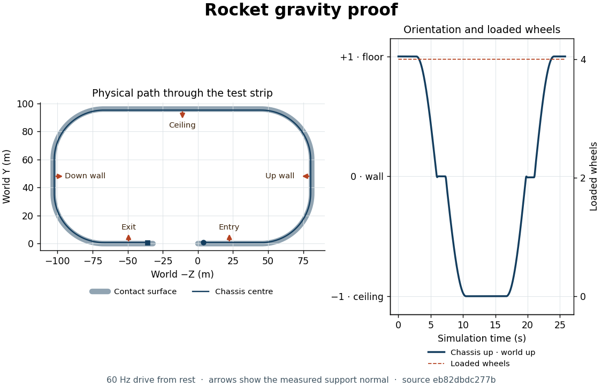

# CO-010A · Surface-relative vehicle dynamics

## Architecture decision

The published v0.9.0 game is the baseline for this review, at `f7f45d1b6c3521dd728945b71cf20ab406603cb4`. The selected VANILLAJS source is `9d95d74b355ec17add32db0b55f0f71130f9c004`.

**Choice A.** The Rocket discipline owns a rigid-body step and a directional wheel-contact interface. Touring and Nitro use their established entry points. The pinned math module supplies vector and quaternion operations.

In the pinned `vehicle3d` implementation, the world returns one height per X/Z query and wheel support requires an upward-facing normal. The solver applies gravity along world −Y, corrects bottom-out along +Y, and requests recovery when chassis up points below its upright threshold. Changing its gravity vector alone leaves all three contact assumptions in place. The collision module casts against axis-aligned boxes. The game's car-pair solver sweeps horizontal chassis footprints. A directional probe against an oriented patch supplies the contact information a ceiling or wall requires. [Pinned vehicle source](../vendor/vanillajs/modules/vehicle3d/index.js) · [Pinned collision source](../vendor/vanillajs/modules/collision/index.js)

## Surface and body contracts

World units are metres, kilograms and seconds. In the local right-handed chassis frame +X points right, +Y points out of the roof and −Z points forward. A surface supplies its position, forward unit tangent T, support unit normal N, lateral axis T × N, patch identity, route station, lateral offset and material. A probe returns the nearest admissible front face along the actual wheel ray and its distance. The returned basis must be finite, orthogonal and consistently handed.

The trusted query `probe(origin, unitDirection, maxDistance, hint)` returns a hit frame with `point`, `normal`, `tangent`, `lateral`, `station`, `offset`, `id`, `material` and ray `distance`, or null. The solver checks the basis, bounds and position of each returned hit against its wheel ray and copies the accepted geometry. The fixture breaks seam ties in connected strip order or preserves an equally near hinted patch. Opposed rays at identical X/Z can find different physical decks.

`createRocketBody(frame)` places a stationary chassis at suspension ride height, oriented to the spawn frame. `stepRocketBody(previous, command, surface)` returns a new state after one 60 Hz tick. Commands have five own data fields. Throttle and brake are finite numbers in [0, 1], steer is in [−1, 1], boost is boolean and dodge is −1, 0 or +1. The full body stores position, normalized quaternion [x,y,z,w], linear and world angular velocity, four wheel samples, support frame, adhesion acceleration, energy, dodge latch and cooldown. Orientation changes after spawn through angular integration.

Each of the four substeps transforms the wheel mounts into world space and casts along the chassis −Y axis. Each loaded wheel contributes a unilateral spring and damper force along its own surface normal. Lateral tyre force and braking share a friction cap of 1.6 times that wheel's load. The motor projects the chassis forward axis onto the supported face. The torque sum uses the contact lever arms, the local inertia tensor and the gyroscopic term. The world angular increment left-multiplies the chassis quaternion. A station records where a ray hit the surface. The vehicle moves by integrating its velocity.

Rocket rules 2 model lateral load transfer through a 0.26 m effective roll arm. The lateral force cap is 1.25 times tyre load at the front and 1.6 at the rear. Full steering requests a front-wheel angle of `0.45 / (1 + 0.085 × |forward speed in m/s|)` radians. These bounds let the chassis take a sustained digital turn and settle after the driver releases it. Brake forces retain their contact-point lever arms.

During a rollover, the race also sweeps 16 points on the physical chassis, including its side panels, canopy and rear wing, against the driving faces of the course triangles. A shell impact changes linear and angular motion. Loaded wheels determine traction and checkpoint credit. A stranded car can rest on the deck until recovery returns it to a safe slot. [Collision tests](../tests/rocket-contact.test.mjs) · [Race and recovery tests](../tests/orbital-race.test.mjs)

**Automatic track gravity (rules 4).** Let `G = (0, −9.81, 0)` m/s² and `N` be the unit normal averaged from eligible magnetic tyre hits. The chassis always experiences world gravity. An attached car also receives a track acceleration `−32 N − G`, giving a net field of 32 m/s² into the deck before suspension, tyres, motor and collision forces. On a vertical wall the field cancels the downward slide. On a flat inverted ceiling the track contributes 41.81 m/s² upward. This is the maximum at any orientation. The springs carry the resulting load. The magnetic track supplies this force even while the car is parked or its boost tank is empty.

Attachment requires at least two loaded wheels on an aligned magnetic face. Once attached, a spring can unload briefly while its ray still intersects a continuation within the 0.72 m probe reach and within 0.06 m of its previous hit plane. Each substep uses the current faces. Losing the second eligible ray releases the car within that substep. No timer extends grip across a gap. A new landing requires real wheel loads before grip engages again.

In free flight world gravity accelerates the car downward. The pedals trim pitch and steering supplies yaw and roll torque. Automatic angular damping and a short-range alignment torque ease landing. These torques preserve the centre-of-mass trajectory. Boost and a paid lateral dodge can change it. A new dodge requires neutral input and an expired cooldown.

| Quantity | Limit or rule |
| --- | --- |
| Body and clock | 1,100 kg, principal moments [1,780, 2,050, 540] kg·m², four 1/240 s substeps per tick |
| Wheel reach and compression | 0.72 m probe, 0.64 m free reach, 0.24 m end stop, 0.40 m maximum spring compression |
| Spring and damper | Per-wheel load equals one quarter of the mass times the bounded spring/damper acceleration, with coefficients 480 s⁻² and 29 s⁻¹ and a 39,875 N wheel-force cap |
| Gravity and adhesion | Free fall at 9.81 m/s². Net track gravity 32 m/s² along −N, magnetic contribution ≤41.81 m/s². Entry requires up·normal ≥ 0.72, retention ≥ 0.55. No speed threshold |
| Propulsion and energy | Motor demand up to 19 m/s², tapering to zero at 48 m/s. Boost adds up to 13 m/s² below the 65 m/s activation cutoff and spends 18 units/s from a 100-unit tank |
| Air dodge | Signed 4 m/s body-lateral impulse before speed limiting, costs 12 units, 60-tick cooldown |
| Integrated motion | 75 m/s linear speed, 6 rad/s angular speed, 352 m/s² continuous acceleration and 120 rad/s² continuous angular acceleration |
| End stops | Up to four constraint sweeps per substep with at most 93,500 N·s total normal impulse per substep. Contact impulses are discrete and reported separately from continuous force |
| Work per body tick | 16 wheel casts, up to 144 analytic patch intersection tests on the nine-patch fixture, up to 64 wheel end-stop evaluations. No recovery search or chassis-pair collision solver runs in this lab |

End stops dissipate the normal closing velocity through linear and angular impulses. They never translate the chassis directly. The wheel samples describe the force calculation at the start of the final substep. The returned pose is the integrated endpoint. The traversal test reverses that last substep to independently reconstruct the four mount rays and compare the contact points to the mathematical deck.

A separate stress run exercised 1,008 vertical impacts against a one-sided plane, at speeds from 4 to 75 m/s and initial roll angles up to ±25°. Sampling every wheel mount at 240 Hz, the largest excursion beyond the nominal suspension end stop was 8.335 mm at 75 m/s and 5° roll. All four wheel mounts stayed above the physical plane and each car settled onto four loaded wheels. The regression allows 10 mm of end-stop overtravel for that inclined, 75 m/s flat-plane landing. This tolerance is specific to the tested impact envelope. Slanted edge strikes and chassis hull penetration require their own geometry and bounds.

## Original CO-010A feasibility proof

The laboratory strip has five finite planes and four quarter-cylinders of radius 36 m, each 14 m wide. The vertical straights are 24 m long. The inverted straight is 112 m long and 96 m above the floor. On the original CO-010A source below, a stationary car starts at station 4 m. A speed governor uses the measured velocity to request throttle or brake around 18 m/s, with assist held. A second run holds full throttle throughout. [Fixture](../tests/fixtures/rocket-proof-surface.mjs) · [Traversal and independent assertions](../tests/rocket-traversal.test.mjs)

At source `eb82dbdc277bae7a277dd6a4d08fd19fd58ea9f7`, the governed drive reached station 462.304 m on the exit floor in 1,548 ticks (25.80 s). All four wheels carried positive load on every sampled tick. The table counts consecutive ticks with every wheel on the named patch and adhesion active. Entry and exit transitions can have wheels on adjacent patches.

| Straight | Four-wheel attachment | Sample tick | World Y | Total wheel reaction |
| --- | ---: | ---: | ---: | ---: |
| Ascending wall | 73 ticks / 1.22 s | 398 | 48.066 m | 35.200 kN |
| Inverted ceiling | 365 ticks / 6.08 s | 815 | 95.266 m | 24.409 kN |
| Descending wall | 70 ticks / 1.17 s | 1,223 | 48.010 m | 35.200 kN |

At tick 815 the wheels pressed upward against the ceiling. Magnetic force on the chassis was 35.200 kN upward. Gravity was 10.791 kN downward and the ceiling exerted 24.409 kN downward through the wheels. Releasing assist from an actual inverted state made the car fall more than 4 m in one second while it continued forward. The full-throttle run reached the exit in 704 ticks with a peak speed of 60.72 m/s. [Five tick-indexed body and surface receipts](evidence/co-010a/rocket-proof.json)



The Node 22.18.0 run reproduced all 1,548 command and body records byte for byte, including playback in different tick batches. Chrome 158.0.8127.36 repeated the same accepted input stream twice, also identically within that browser. Both observed the same nine patch IDs and loaded-contact intervals. Their full-state digests differ at floating-point precision. The source and both digests are in the receipt.

## Reproduction and scope

From the source checkout, run the following. The optional trace file must be a fresh path.

```sh
node --test tests/rocket*.test.mjs
node tests/rocket-traversal.mjs --ticks /tmp/rocket-ticks.jsonl
sha256sum /tmp/rocket-ticks.jsonl
```

At the CO-010A source recorded above, the governed JSONL SHA-256 was `dbe530b979899d6d7cbbe1f13bcf01f401b8434e1e2e865ad4a8d5d0c6c4857c`. Each line contains the accepted command and complete resulting body. Unit tests also cover out-of-reach and back-facing surfaces, partial wheel support, incorrect intersections, air-control damping, input rejection, fuel depletion, held dodges, end stops and independent storage of wheel contact data. [Dynamics tests](../tests/rocket-dynamics.test.mjs) · [3D query tests](../tests/rocket-proof-surface.test.mjs)

This proof covers directional wheel support on a connected, stationary strip and open-edge departure under gravity. The suspension and magnetic acceleration are arcade approximations. Sideways chassis impacts, inter-car sweeps, oriented barriers, ordered race gates and recovery belong to the Orbital Spine and six-car reviews. The single-car proof runs from the checkout. The offline game still packages the released player modes, with source-stamped v2 touring and v3 Nitro playback under their existing revision policies.
